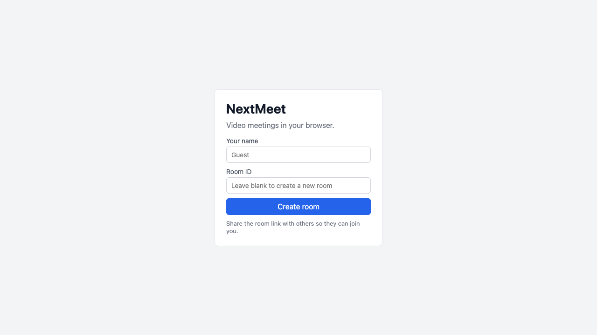
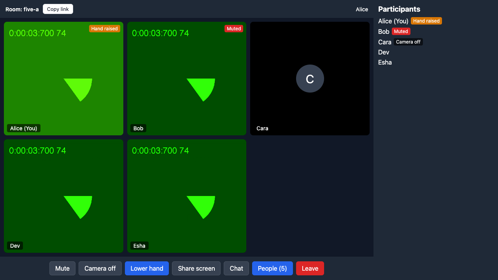
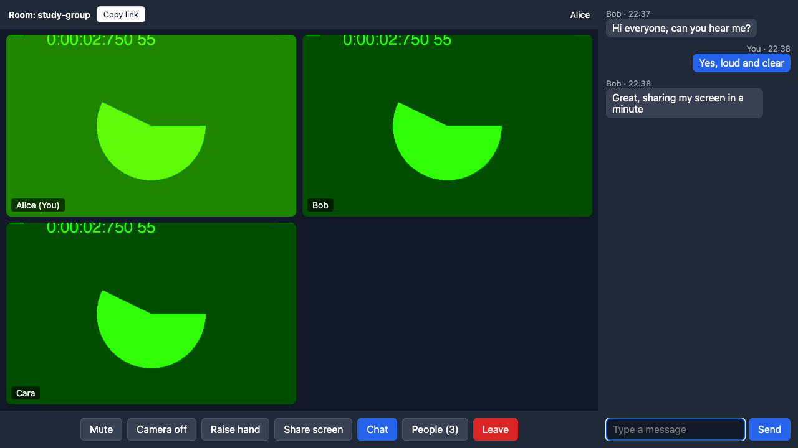
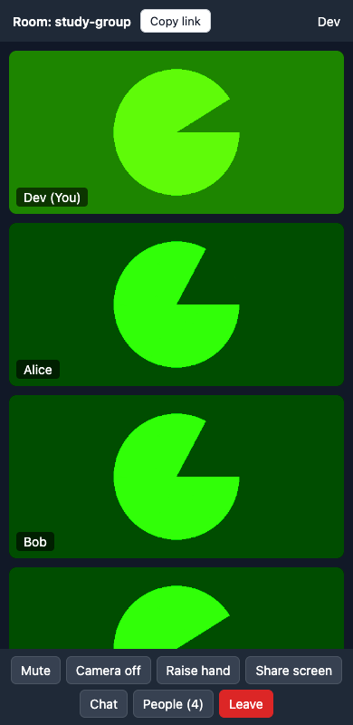

# NextMeet

A browser based video meeting app. Real-time multi-user video rooms built on **WebRTC** (peer-to-peer mesh) with **Socket.IO** signaling.

## Features

- Multi-user video rooms with an automatic video grid
- Live in-room chat with unread counts
- Screen sharing (the video track is swapped, no renegotiation)
- Mic and camera toggles, synced to everyone in the room (late joiners see the current state)
- Raise hand, shown on your tile and in the participant list
- Keyboard shortcuts: **M** mute, **V** camera, **H** raise hand, **C** chat
- Participant list with muted, camera off and sharing indicators
- Copy-link button and a leave button
- Falls back to audio-only or video-only if one device is missing
- Connection recovery: ICE restart, then a full peer-connection rebuild, and an automatic re-join if the signaling socket drops
- STUN plus optional TURN fallback for peers behind strict NATs
- Metrics endpoint (`/metrics`) to measure setup failures and recovery rate

## Screenshots

| Home | Meeting with 5 participants |
|---|---|
|  |  |

| Chat | Mobile |
|---|---|
|  |  |

## Tech stack

React · Vite · JavaScript · WebRTC · Socket.IO · Node.js · Express

## How it works

```
Browser A ──┐                         ┌── Browser B
            │   offer/answer/ICE      │
            └──►  Signaling server  ◄─┘     (Node + Express + Socket.IO)

Browser A ◄════ audio/video (direct P2P, or relayed via TURN) ════► Browser B
```

- The **signaling server** only passes offers, answers, ICE candidates, chat and room state. It never carries media.
- **Mesh topology:** every participant connects to every other one. This works well for about 2 to 5 people. An SFU (LiveKit, mediasoup) would be needed to go beyond that.
- **Glare avoidance:** the newcomer always sends the offers, and only the original offerer performs ICE restarts.

### Server behaviour

- Room size is limited (`MAX_ROOM_SIZE`, default 6). A full room shows a message instead of joining.
- Signaling messages are only relayed between people in the same room.
- The sender's name comes from the server, chat text is limited to 1000 characters, and each user can send at most 20 messages per 10 seconds.
- An error in one event handler is logged and never stops the server.

### Connection recovery

| Event | Action |
|---|---|
| ICE `disconnected` | Wait 3 s, then ICE restart |
| ICE `failed` | ICE restart immediately (up to 3 times) |
| Restarts exhausted | Rebuild the peer connection (up to 2 times) |
| Signaling socket drops | Reconnect and re-join the room |

## Project structure

```
Nextmeet/
├── client/                      React app (Vite)
│   ├── public/favicon.svg
│   ├── src/
│   │   ├── App.jsx              routes and the home page (name and room ID)
│   │   ├── Room.jsx             meeting screen: video grid, controls, side panels, shortcuts
│   │   ├── useRoom.js           hook with all the WebRTC and Socket.IO logic
│   │   │                        (peer connections, recovery, media state, screen share)
│   │   ├── VideoTile.jsx        one participant: video or avatar, name and badges
│   │   ├── Chat.jsx             chat panel
│   │   ├── index.css            all styles
│   │   └── main.jsx
│   ├── index.html
│   ├── vercel.json              rewrites every path to the app so room links survive a refresh
│   ├── .env.example
│   └── package.json
├── server/                      signaling server
│   ├── index.js                 Express and Socket.IO: rooms, signaling relay, chat, metrics
│   ├── test/
│   │   └── signaling.test.js
│   ├── .env.example
│   └── package.json
├── docs/                        screenshots used in this README
├── render.yaml                  Render deployment for the server
├── README.md
└── .gitignore
```

## Getting started

Requires Node.js 18 or newer.

```bash
# server
cd server
npm install
npm start            # http://localhost:5000

# client (second terminal)
cd client
npm install
npm run dev          # http://localhost:5173
```

Open two tabs at `http://localhost:5173/room/test` (camera access needs `localhost` or HTTPS).

### Environment variables

Client (`client/.env.local`, see `client/.env.example`):

| Variable | Purpose |
|---|---|
| `VITE_SERVER_URL` | Signaling server URL (default `http://localhost:5000`) |
| `VITE_TURN_USERNAME`, `VITE_TURN_PASSWORD` | Optional TURN credentials. Without them only STUN is used. Free TURN: metered.ca |

Server (see `server/.env.example`):

| Variable | Purpose |
|---|---|
| `PORT` | Port to listen on (default `5000`) |
| `CLIENT_URL` | Allowed frontend origin(s), comma separated (default `*`) |
| `MAX_ROOM_SIZE` | Maximum people per room (default `6`) |

### Tests

```bash
cd server
npm test
```

10 tests cover the signaling server: chat, room state for late joiners, the room size limit, same-room signaling, input validation, rate limiting, leaving, and the metrics.

The full app was also tried in headless Chrome with fake cameras and microphones, with rooms of up to 5 participants on one machine: everyone sees everyone's video, chat reaches all participants, mute, camera and raise-hand states sync, people can leave, and clients reconnect and restore video after the server is restarted.

### Testing flags

| URL suffix | Effect |
|---|---|
| `?relay=1` | Force all media through TURN |
| `?turn=0` | Disable TURN |
| `?recovery=0` | Disable recovery logic (baseline) |

## API

| Route | Description |
|---|---|
| `GET /` | Plain text health check |
| `GET /health` | JSON with the number of rooms and participants |
| `GET /metrics` | Setup failure rate, unrecovered rate and median recovery time per variant (`?raw=1` for raw events) |

## Deployment

- **Server (Render):** `render.yaml` in the repository root. Set `CLIENT_URL` to the frontend URL.
- **Client (Vercel):** set the root directory to `client` and add `VITE_SERVER_URL` pointing at the Render service. `vercel.json` rewrites all paths to the app so room links work after a refresh.
- **TURN:** a free Metered account is enough for testing.

## Results

Measured with the app's own `/metrics` endpoint: 41 peer connections across three 5-person rooms and a 2-person room, using headless Chrome with fake devices on a single machine (localhost).

| Measure | Result |
|---|---|
| Peer connections set up | 41 |
| Setup failures | 0 (0%) |
| Median setup time | 118 ms |
| Slowest setup | 1409 ms |

This is a sanity check on the signaling and ICE flow on a loopback network. It says nothing about real networks, NATs or TURN. Recovery after real connection drops (the `disruption` and `recovered` metrics) has not been measured yet, so there is no baseline versus recovery comparison. To collect one, run sessions with `?recovery=0` (baseline) and with the defaults over real networks, then read `/metrics`.

## Limitations and future work

- The mesh does not scale past about 5 participants (an SFU would fix this)
- No authentication or room passwords, so anyone with the room ID can join
- Metrics are stored in memory only and reset when the server restarts
- If a device has no camera, screen sharing is not sent to peers
- Tested on desktop Chrome only
